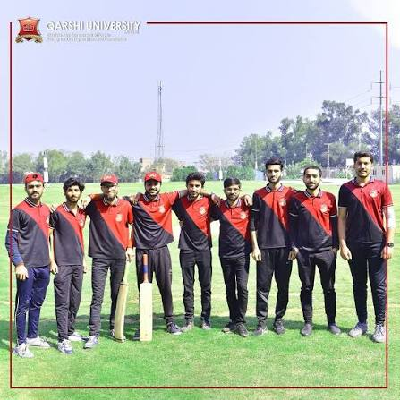

# Qarshi Sports Society

A three-page website for a university sports club, built for CIT331 Assignment 1 with plain HTML, CSS and a little JavaScript.

Live site: <PASTE YOUR GITHUB PAGES LINK HERE>

## Pages
- index.html: society description, featured event, contact box
- events.html: four upcoming sports events
- register.html: registration form and saved registrations (stored in localStorage)

## Run locally
Open the project folder in VS Code and use "Open with Live Server" on index.html.

## Screenshot

## Image sources
- images/club.jpg: https://www.instagram.com/p/C58VPxIIOBl/